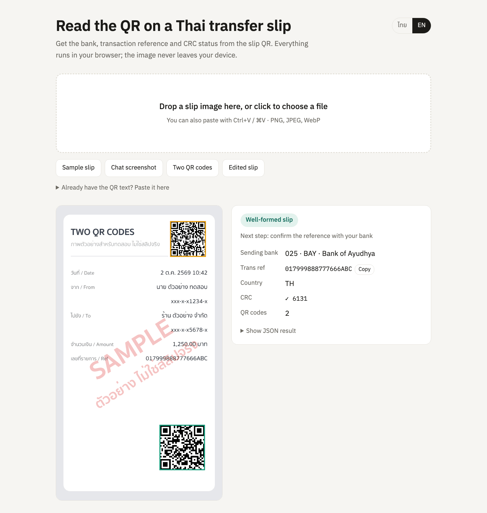

# promptpay-slip-parser

English | [ภาษาไทย](README.th.md)

Read Thai bank transfer slips in Node.js or the browser. Finds the QR on a slip image, checks its CRC, tells you which bank sent the money, and stops the same slip from being used twice.

[](https://github.com/nuttakulsv/promptpay-slip-parser/actions/workflows/ci.yml)
[](https://www.npmjs.com/package/promptpay-slip-parser)
[](https://bundlephobia.com/package/promptpay-slip-parser)
[](LICENSE)

[](https://nuttakulsv.github.io/promptpay-slip-parser/)

**[Try it in your browser](https://nuttakulsv.github.io/promptpay-slip-parser/)**. The image is decoded on your device and never uploaded.

```bash
npm i promptpay-slip-parser
npx promptpay-slip-parser slip.jpg
```

```js
const result = await readSlip(imageBytes) // from 'promptpay-slip-parser/image'
if (result.ok) console.log(result.slip.bank?.abbr, result.slip.transRef)
```

## What it looks like

```console
$ npx promptpay-slip-parser test/fixtures/chat-screenshot.png
Bank transfer slip
  Bank        006 KTB  ธนาคารกรุงไทย / Krungthai Bank
  Trans ref   KTB2610021042000123
  CRC         OK (8EF2)

A valid QR only means the payload is well-formed, not that the money arrived.
Check the reference with your bank or a slip verification service before you ship.

$ npx promptpay-slip-parser test/fixtures/tampered.png
CRC mismatch: payload says D70E, content gives C05E. The QR was edited or misread.
Bank transfer slip
  Bank        004 KBANK  ธนาคารกสิกรไทย / Kasikornbank
  Trans ref   016275104552BTF04999
  CRC         MISMATCH (D70E)

$ echo $?
3
```

The images in `test/fixtures` are synthetic and marked SAMPLE. There is no real customer data in this repository.

## Why

Every Thai bank app prints a small QR on the transfer slip. That QR is not a payment QR. It is the "Slip Verify mini-QR" from the Bank of Thailand standard, and it carries two things you need: the code of the sending bank and the transaction reference (`transRef`) that bank APIs use to look the transfer up.

Shops that take PromptPay over LINE or a web form usually end up doing one of two things: check every slip by hand against the bank statement, or pay a slip-checking service per request. Both are fine, but a lot of the work can be done for free, before any API call:

- pull the QR out of a photo, a screenshot, or a slip forwarded inside a chat screenshot
- reject QR codes that were edited (CRC mismatch), payment QRs sent by mistake, and images with no slip at all
- reject a slip that was already used for another order, which is the most common trick
- only then spend an API call on the slips that are left

This package does those steps. It also builds and reads PromptPay QR codes, so the same library covers "show the customer a QR with the amount" and "read the slip they send back".

## Install

```bash
npm i promptpay-slip-parser
```

Node.js 20 or newer, or any modern browser. The core (`promptpay-slip-parser`) has no dependencies and is about 5 KB gzipped. Reading images (`promptpay-slip-parser/image`) uses [zxing-wasm](https://github.com/Sec-ant/zxing-wasm), a WebAssembly build of ZXing-C++, so there is nothing native to compile.

## Quick start

### Read a slip image

```ts
import { readFile } from 'node:fs/promises'
import { readSlip } from 'promptpay-slip-parser/image'

const result = await readSlip(await readFile('slip.jpg'))

if (result.ok) {
  const { slip } = result
  if (slip.kind === 'bank') {
    console.log(slip.sendingBank, slip.bank?.nameTh, slip.transRef)
  } else {
    console.log('TrueMoney', slip.transactionId)
  }
} else {
  console.log(result.code, result.message) // NO_QR_FOUND, CRC_MISMATCH, PROMPTPAY_QR, ...
}
```

`readSlip` accepts a `Uint8Array` or Node `Buffer`, an `ArrayBuffer`, a `Blob` / `File`, or `ImageData`. PNG, JPEG, WebP, GIF and BMP all work. On an Apple M2 a 720×1280 slip takes about 10 ms and a full 1170×2532 phone screenshot about 28 ms; the first call also loads the WebAssembly module (about 0.7 s).

### Parse QR text you already have

If your scanner or a LINE bot already gives you the QR text, skip the image step:

```ts
import { parseSlip } from 'promptpay-slip-parser'

const result = parseSlip('004100060000010103014022000111222233344ABCD125102TH910417DF')
// { ok: true, slip: { kind: 'bank', sendingBank: '014', bank: { abbr: 'SCB', ... },
//   transRef: '00111222233344ABCD12', country: 'TH', crc: { valid: true, ... }, warnings: [] } }
```

### Block reused slips

```ts
import { createSlipGuard } from 'promptpay-slip-parser'

const guard = createSlipGuard() // in memory; pass { store } for Redis, see below

const claim = await guard.claim(result.slip)
if (!claim.ok) throw new Error('This slip was already used')
```

`claim` is atomic. Fifty requests with the same slip at the same moment get exactly one `ok: true` (there is a test for that). Used slips are remembered for 30 days by default (`ttlSeconds`).

The memory store only works inside one process. For more than one instance use the Redis store in [`examples/redis-store.js`](examples/redis-store.js), or, best of all, a unique index on `(sending_bank, trans_ref)` in your payments table.

### Confirm the transfer with your bank

```ts
import { verifySlip } from 'promptpay-slip-parser'
import { scbVerifier } from './examples/verifiers.js'

const verifier = scbVerifier({ apiKey: process.env.SCB_API_KEY, getToken })
const check = await verifySlip(result.slip, verifier, {
  amount: 1250,
  receiverAccount: '123-4-56789-0', // compared with the masked value the bank returns
  maxAgeMinutes: 60,
})

if (!check.ok) console.log(check.reason, check.problems)
```

A verifier is just `(slip) => Promise<Transfer | null>`. The package does not ship API clients because every provider needs its own credentials and contract. [`examples/verifiers.js`](examples/verifiers.js) maps the SCB and KBank Open API response format (written from their docs and tested against mocked responses, not the live APIs) and has a template for paid checking services.

### Make a PromptPay QR to receive money

```ts
import { createPromptPay } from 'promptpay-slip-parser'

createPromptPay({ target: '0812223333', amount: 30 })
// '00020101021229370016A0000006770101110113006681222333353037645802TH540530.0063043CAD'
```

Render the string with any QR library, or use the CLI:

```console
$ npx promptpay-slip-parser qr 0812345678 --amount 150 -o qr.png
00020101021229370016A0000006770101110113006681234567853037645802TH5406150.00630466EF
Saved qr.png
```

Without `-o` it draws the QR in the terminal.

## Examples

| File                                                   | What it shows                                                                 |
| ------------------------------------------------------ | ----------------------------------------------------------------------------- |
| [`examples/express`](examples/express/server.js)       | Upload endpoint: read slip, block duplicates, verify, answer with 202/409/422 |
| [`examples/line-webhook.js`](examples/line-webhook.js) | LINE OA bot that reads slip images sent in chat and replies in Thai           |
| [`examples/redis-store.js`](examples/redis-store.js)   | `SlipStore` on Redis (`SET NX EX`) for multi-instance apps                    |
| [`examples/verifiers.js`](examples/verifiers.js)       | SCB and KBank slip verification API mappings, plus a generic template         |
| [`examples/browser`](examples/browser)                 | The demo page. Run `npm run demo` to serve it locally                         |

The Express example, run against the fixtures. The first upload gets 202, the same slip again gets 409, a payment QR gets 422:

```console
$ curl -F slip=@bank-basic.png localhost:3000/orders/42/slip
{"status":"pending","slip":{"bank":"KBANK","transRef":"016275104552BTF04123"}}
$ curl -F slip=@bank-basic.png localhost:3000/orders/42/slip
{"error":"DUPLICATE_SLIP","message":"This slip was already used"}
$ curl -F slip=@promptpay-only.png localhost:3000/orders/42/slip
{"error":"PROMPTPAY_QR","message":"This is a PromptPay payment QR (the code you scan to pay), not a transfer slip"}
```

## API

### `promptpay-slip-parser`

| Function                                                       | Returns                                                         |
| -------------------------------------------------------------- | --------------------------------------------------------------- |
| `parseSlip(text)`                                              | `{ ok: true, slip }` or `{ ok: false, code, message, slip? }`   |
| `slipKey(slip)`                                                | Stable de-duplication key, e.g. `bank:004:016275104552BTF04123` |
| `createSlipGuard({ store?, ttlSeconds?, prefix? })`            | `{ claim(slip), release(slip) }`                                |
| `MemoryStore`                                                  | Default in-process `SlipStore`                                  |
| `verifySlip(slip, verifier, expect?)`                          | `{ ok: true, transfer }` or `{ ok: false, reason, problems? }`  |
| `checkTransfer(transfer, expect)`                              | List of problems, empty when the transfer matches               |
| `matchesAccount(masked, account)`                              | `true` if `xxx-x-x5678-x` fits `123-4-55678-9`                  |
| `parsePromptPay(text)`                                         | `{ ok: true, qr }` with recipient, biller, amount, message      |
| `createPromptPay({ target, amount?, type? })`                  | Payload string (mobile, 13-digit ID or 15-digit e-wallet)       |
| `createBillPayment({ billerId, ref1, ref2?, ref3?, amount? })` | Payload string (tag 30)                                         |
| `getBank(code)` / `banks`                                      | Bank info by BOT code                                           |
| `decodeTlv`, `encodeTlv`, `crc16`                              | Low-level helpers                                               |

A `BankSlip` has `kind: 'bank'`, `sendingBank`, `bank?`, `transRef`, `country?`, `crc`, `raw` and `warnings`. A `TrueMoneySlip` has `kind: 'truemoney'`, `eventType`, `transactionId`, `date` (DDMMYYYY), `crc`, `raw` and `warnings`.

Error codes from `parseSlip` and `readSlip`:

| Code           | Meaning                                                                                           |
| -------------- | ------------------------------------------------------------------------------------------------- |
| `NO_QR_FOUND`  | No QR code in the image (`readSlip` only)                                                         |
| `CRC_MISMATCH` | Layout is a slip but the checksum does not match. `slip` is included so you can log what was read |
| `PROMPTPAY_QR` | It is a payment QR, not a slip. The customer probably sent the wrong picture                      |
| `NOT_A_SLIP`   | Valid TLV, but not the slip layout                                                                |
| `MALFORMED`    | Not TLV at all (a URL, plain text, a different kind of QR)                                        |
| `EMPTY`        | Empty text                                                                                        |

### `promptpay-slip-parser/image`

| Function             | Returns                                                                                      |
| -------------------- | -------------------------------------------------------------------------------------------- |
| `readSlip(image)`    | Same result as `parseSlip` plus `codes`: every QR found, its text, position and parse result |
| `readQrCodes(image)` | Every QR code in the image with its position                                                 |
| `setWasmUrl(url)`    | Load `zxing_reader.wasm` from your own server (browser)                                      |

### CLI

```
promptpay-slip-parser <image | payload | -> [--json]
promptpay-slip-parser qr <mobile | id> [--amount <baht>] [-o file.png|file.svg]
```

Exit codes: `0` slip OK, `1` no slip found, `2` usage or file error, `3` CRC mismatch. `--json` prints the same object the library returns, so it is easy to use from shell scripts or other languages.

## Using it in the browser

The image module works in browsers as is. By default zxing-wasm downloads `zxing_reader.wasm` (about 930 KB, 400 KB gzipped) from jsDelivr on first use. To serve it yourself, for offline use or a strict CSP:

```ts
import { readSlip, setWasmUrl } from 'promptpay-slip-parser/image'
import wasmUrl from 'zxing-wasm/reader/zxing_reader.wasm?url' // Vite; or copy the file to /public

setWasmUrl(wasmUrl)
const result = await readSlip(fileInput.files[0])
```

The demo in [`examples/browser`](examples/browser) does exactly this. Decoding a slip there makes no network request at all.

## Payload format

Both slip and payment QR codes use EMVCo-style TLV: a 2-digit tag id, a 2-digit length, then the value. Templates nest the same way.

### Bank slip (Slip Verify mini-QR)

```
00 41 [00 06 000001] [01 03 014] [02 20 00111222233344ABCD12]   51 02 TH   91 04 17DF
```

| Tag | Sub | Meaning                                                      |
| --- | --- | ------------------------------------------------------------ |
| 00  |     | Root template                                                |
|     | 00  | API id, always `000001`                                      |
|     | 01  | Sending bank code (3 digits, BOT)                            |
|     | 02  | Transaction reference (`transRef`)                           |
| 51  |     | Country code, `TH`                                           |
| 91  |     | CRC-16/CCITT-FALSE of everything before it, including `9104` |

Some bank apps drop leading zeros from the CRC (`9104ABC` instead of `91040ABC`). The parser pads it back and adds a warning.

### TrueMoney Wallet slip

| Tag | Sub | Meaning                                  |
| --- | --- | ---------------------------------------- |
| 00  | 00  | `01`                                     |
|     | 01  | `01`                                     |
|     | 02  | Event type, e.g. `P2P`                   |
|     | 03  | Transaction id                           |
|     | 04  | Date, DDMMYYYY                           |
| 91  |     | CRC, printed in lowercase hex. No tag 51 |

### PromptPay payment QR

| Tag | Meaning                                                                                                                |
| --- | ---------------------------------------------------------------------------------------------------------------------- |
| 00  | Payload format, `01`                                                                                                   |
| 01  | `11` static (payer types the amount), `12` dynamic                                                                     |
| 29  | PromptPay: AID `A000000677010111`, then 01 mobile `0066xxxxxxxxx`, 02 national/tax ID, 03 e-wallet id, 04 bank account |
| 30  | Bill payment: AID `A000000677010112`, 01 biller id, 02 ref1, 03 ref2                                                   |
| 53  | Currency, `764` (THB)                                                                                                  |
| 54  | Amount, e.g. `150.00`                                                                                                  |
| 58  | Country, `TH`                                                                                                          |
| 62  | Additional data (07 is used as ref3 by some banks)                                                                     |
| 81  | TrueMoney personal message, UTF-16BE hex                                                                               |
| 63  | CRC-16/CCITT-FALSE                                                                                                     |

CRC-16/CCITT-FALSE: polynomial `0x1021`, initial value `0xFFFF`, no reflection, no final XOR, over the UTF-8 bytes. Check value for `123456789` is `29B1`.

Bank codes and their sources are listed in [docs/banks.md](docs/banks.md).

## Security notes

Read this part before you use the package for anything involving money.

- **A valid QR does not prove a transfer happened.** The format is public and the CRC is not a signature. Anyone can produce a QR that passes `parseSlip`, with any bank code and any reference. What a valid QR does tell you is that the payload was not edited after it was made, and which bank and reference to ask about.
- Confirm with the bank. Call the sending bank's slip verification API (or a service that does) with `sendingBank` and `transRef`, then check the amount, the receiving account and the time. `verifySlip` and `checkTransfer` do the comparison; you supply the API call.
- Block reuse. The same real slip can be sent for two orders. Claim the slip before you confirm the order, and release it only when the failure was not the customer's (provider down, not found yet).
- Don't trust what is printed on the slip. Amount, names and dates on the image are pixels. Only the QR and the bank's answer matter. This package deliberately does not OCR the slip text.
- The package itself never sends data anywhere. Only your verifier does.

## FAQ

### Can it tell me the amount?

No. The slip QR does not contain the amount. You get it from the bank API.

### Is a slip with an unknown bank code rejected?

No. It parses, `bank` is undefined and `warnings` says the code is unknown. New banks show up (CLICX got code 088 in 2026), so rejecting unknown codes would break real slips.

### The QR is not found in my image.

Very small or heavily compressed QR codes can fail. LINE and Facebook re-compress images; ask for the original file if you can, or crop around the QR. If you have an image that should work, open an issue with a version where personal data is blurred out (keep the QR intact).

### Does it read K PLUS / SCB EASY / other e-slips without a QR?

No. Without the QR there is nothing reliable to read.

### Python? PHP?

The CLI with `--json` works from any language. The format tables above are enough to port the parser; `src/slip.ts` and `src/tlv.ts` together are about 220 lines.

## Development

```bash
npm install
npm test          # vitest, includes real image decoding and CLI runs
npm run lint && npm run typecheck
npm run fixtures  # re-render the synthetic slips in test/fixtures
npm run demo      # build the browser demo and serve it
```

## Acknowledgements

The payload layouts were cross-checked against prior work by Maythiwat Chomchuen: [promptparse](https://github.com/maythiwat/promptparse), whose published test vectors are reused in this test suite, and [slipverify](https://github.com/maythiwat/slipverify). No code was copied from either project. Image decoding is done by [zxing-wasm](https://github.com/Sec-ant/zxing-wasm).

## Contributing

Issues and pull requests are welcome; see [CONTRIBUTING.md](CONTRIBUTING.md). Please never attach a real slip with readable personal information.

## License

[MIT](LICENSE)
