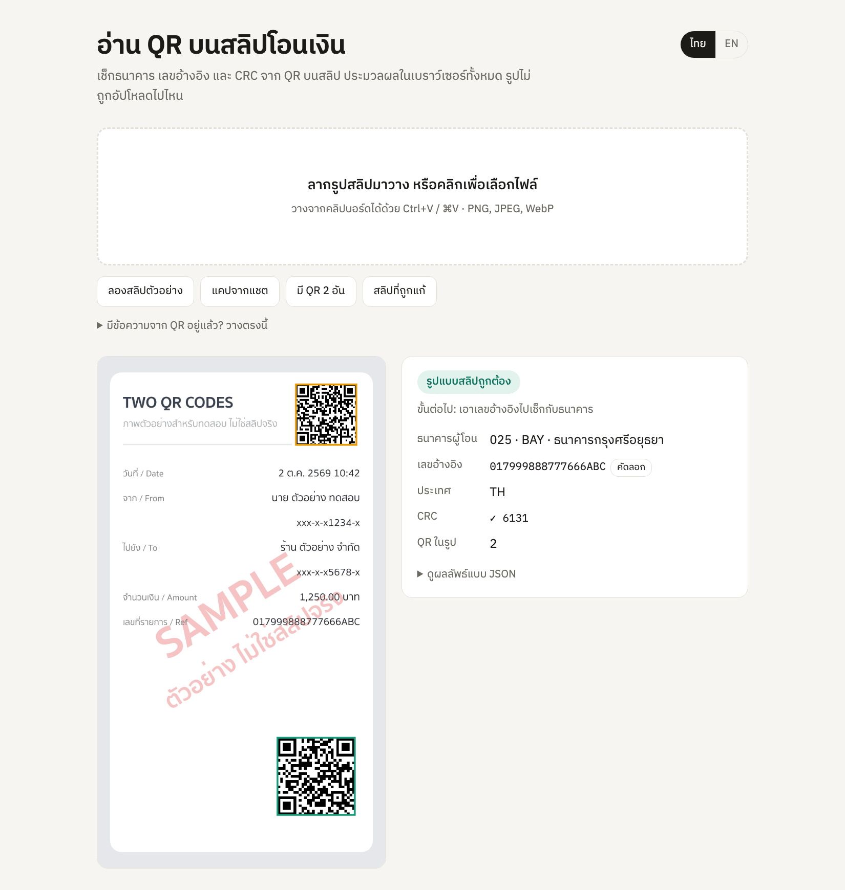

# promptpay-slip-parser

[English](README.md) | ภาษาไทย

ไลบรารีอ่านสลิปโอนเงินของไทย ใช้ได้ทั้ง Node.js และเบราว์เซอร์ หา QR บนรูปสลิปให้เอง เช็ก CRC บอกว่าโอนมาจากธนาคารไหน และกันไม่ให้สลิปใบเดิมถูกใช้ซ้ำ

[](https://github.com/nuttakulsv/promptpay-slip-parser/actions/workflows/ci.yml)
[](https://www.npmjs.com/package/promptpay-slip-parser)
[](https://bundlephobia.com/package/promptpay-slip-parser)
[](LICENSE)

[](https://nuttakulsv.github.io/promptpay-slip-parser/)

**[ลองในเบราว์เซอร์](https://nuttakulsv.github.io/promptpay-slip-parser/)** รูปถูกประมวลผลบนเครื่องคุณ ไม่ได้อัปโหลดไปไหน

```bash
npm i promptpay-slip-parser
npx promptpay-slip-parser slip.jpg
```

```js
const result = await readSlip(imageBytes) // จาก 'promptpay-slip-parser/image'
if (result.ok) console.log(result.slip.bank?.abbr, result.slip.transRef)
```

## หน้าตาตอนใช้งาน

```console
$ npx promptpay-slip-parser test/fixtures/chat-screenshot.png
Bank transfer slip
  Bank        006 KTB  ธนาคารกรุงไทย / Krungthai Bank
  Trans ref   KTB2610021042000123
  CRC         OK (8EF2)

A valid QR only means the payload is well-formed, not that the money arrived.
Check the reference with your bank or a slip verification service before you ship.

$ npx promptpay-slip-parser test/fixtures/tampered.png
CRC mismatch: payload says D70E, content gives C05E. The QR was edited or misread.
Bank transfer slip
  Bank        004 KBANK  ธนาคารกสิกรไทย / Kasikornbank
  Trans ref   016275104552BTF04999
  CRC         MISMATCH (D70E)

$ echo $?
3
```

รูปใน `test/fixtures` เป็นสลิปจำลองทั้งหมด มีคำว่า SAMPLE ตัวใหญ่ ไม่มีข้อมูลลูกค้าจริงอยู่ใน repo นี้

## ทำไมถึงมีโปรเจกต์นี้

สลิปจากแอปธนาคารทุกเจ้าจะมี QR เล็ก ๆ อยู่มุมหนึ่ง QR ตัวนี้ไม่ใช่ QR รับเงิน แต่เป็น "Slip Verify mini-QR" ตามมาตรฐานของแบงก์ชาติ ข้างในมีข้อมูลสองอย่างที่เราต้องใช้ คือรหัสธนาคารผู้โอน กับเลขอ้างอิงรายการ (`transRef`) ที่ API ของธนาคารใช้ค้นหารายการโอน

ร้านที่รับ PromptPay ผ่าน LINE หรือฟอร์มบนเว็บ ส่วนใหญ่จะเลือกได้สองทาง คือนั่งไล่เช็กสลิปกับ statement ทีละใบ หรือจ่ายเงินให้บริการตรวจสลิปเป็นรายครั้ง ทั้งสองทางใช้ได้ แต่มีงานหลายส่วนที่ทำได้ฟรีก่อนจะยิง API สักครั้ง

- ดึง QR ออกมาจากรูปถ่าย ภาพแคปหน้าจอ หรือแม้แต่สลิปที่ถูกส่งต่อมาในรูปแคปแชตอีกที
- ตีกลับ QR ที่ถูกแก้ข้อมูล (CRC ไม่ตรง) QR รับเงินที่ลูกค้าส่งมาผิดรูป และรูปที่ไม่มีสลิปเลย
- ตีกลับสลิปที่เคยใช้กับออเดอร์อื่นไปแล้ว ซึ่งเป็นวิธีโกงที่เจอบ่อยที่สุด
- สลิปที่เหลือรอดมาค่อยเสียค่า API ตรวจกับธนาคาร

ไลบรารีนี้ทำขั้นตอนเหล่านั้นให้ และยังสร้างกับอ่าน QR PromptPay ได้ด้วย ใช้ตัวเดียวจบทั้งฝั่ง "สร้าง QR พร้อมยอดเงินให้ลูกค้าสแกน" และ "อ่านสลิปที่ลูกค้าส่งกลับมา"

## ติดตั้ง

```bash
npm i promptpay-slip-parser
```

ต้องใช้ Node.js 20 ขึ้นไป หรือเบราว์เซอร์รุ่นใหม่ ตัว core (`promptpay-slip-parser`) ไม่มี dependency เลย ขนาดราว 5 KB หลัง gzip ส่วนอ่านรูป (`promptpay-slip-parser/image`) ใช้ [zxing-wasm](https://github.com/Sec-ant/zxing-wasm) ซึ่งเป็น ZXing-C++ ที่คอมไพล์เป็น WebAssembly ไม่ต้องลง native module ใด ๆ

## เริ่มต้นใช้งาน

### อ่านสลิปจากรูป

```ts
import { readFile } from 'node:fs/promises'
import { readSlip } from 'promptpay-slip-parser/image'

const result = await readSlip(await readFile('slip.jpg'))

if (result.ok) {
  const { slip } = result
  if (slip.kind === 'bank') {
    console.log(slip.sendingBank, slip.bank?.nameTh, slip.transRef)
  } else {
    console.log('TrueMoney', slip.transactionId)
  }
} else {
  console.log(result.code, result.message) // NO_QR_FOUND, CRC_MISMATCH, PROMPTPAY_QR, ...
}
```

`readSlip` รับได้ทั้ง `Uint8Array` หรือ `Buffer` ของ Node, `ArrayBuffer`, `Blob` / `File` และ `ImageData` ไฟล์ PNG, JPEG, WebP, GIF, BMP ใช้ได้หมด บน Apple M2 สลิปขนาด 720×1280 ใช้เวลาราว 10 ms ภาพแคปหน้าจอมือถือเต็มจอ 1170×2532 ราว 28 ms ส่วนการเรียกครั้งแรกจะช้ากว่านิดหน่อย (ประมาณ 0.7 วินาที) เพราะต้องโหลด WebAssembly ก่อน

### มีข้อความจาก QR อยู่แล้ว

ถ้าเครื่องสแกนหรือบอท LINE อ่าน QR ให้แล้ว ข้ามขั้นตอนอ่านรูปไปได้เลย

```ts
import { parseSlip } from 'promptpay-slip-parser'

const result = parseSlip('004100060000010103014022000111222233344ABCD125102TH910417DF')
// { ok: true, slip: { kind: 'bank', sendingBank: '014', bank: { abbr: 'SCB', ... },
//   transRef: '00111222233344ABCD12', country: 'TH', crc: { valid: true, ... }, warnings: [] } }
```

### กันสลิปซ้ำ

```ts
import { createSlipGuard } from 'promptpay-slip-parser'

const guard = createSlipGuard() // เก็บใน memory ถ้าจะใช้ Redis ให้ส่ง { store } (ดูด้านล่าง)

const claim = await guard.claim(result.slip)
if (!claim.ok) throw new Error('สลิปนี้ถูกใช้ไปแล้ว')
```

`claim` เป็น atomic ต่อให้มี 50 request ส่งสลิปใบเดียวกันเข้ามาพร้อมกัน ก็จะมีแค่ request เดียวที่ได้ `ok: true` (มีเทสต์เคสนี้อยู่) ค่าเริ่มต้นจะจำสลิปที่ใช้แล้วไว้ 30 วัน ปรับได้ด้วย `ttlSeconds`

memory store ใช้ได้เฉพาะตอนรันโปรเซสเดียว ถ้ามีหลาย instance ให้ใช้ Redis store ใน [`examples/redis-store.js`](examples/redis-store.js) หรือดีที่สุดคือทำ unique index ที่ `(sending_bank, trans_ref)` ในตาราง payment ของคุณเลย

### ตรวจกับธนาคารว่าเงินเข้าจริง

```ts
import { verifySlip } from 'promptpay-slip-parser'
import { scbVerifier } from './examples/verifiers.js'

const verifier = scbVerifier({ apiKey: process.env.SCB_API_KEY, getToken })
const check = await verifySlip(result.slip, verifier, {
  amount: 1250,
  receiverAccount: '123-4-56789-0', // เทียบกับเลขบัญชีแบบปิดบางหลักที่ธนาคารส่งกลับมา
  maxAgeMinutes: 60,
})

if (!check.ok) console.log(check.reason, check.problems)
```

verifier คือฟังก์ชัน `(slip) => Promise<Transfer | null>` ธรรมดา ๆ ในแพ็กเกจไม่ได้ใส่ client ของ API เจ้าไหนมาให้ เพราะแต่ละเจ้าต้องใช้ credential และสัญญาของตัวเอง ใน [`examples/verifiers.js`](examples/verifiers.js) มีตัวอย่างแปลง response ของ API ตรวจสลิปจาก SCB กับ KBank (เขียนตามเอกสารและทดสอบกับ response จำลอง ยังไม่ได้ลองกับ API จริง) และ template สำหรับบริการตรวจสลิปแบบเสียเงิน

### สร้าง QR PromptPay สำหรับรับเงิน

```ts
import { createPromptPay } from 'promptpay-slip-parser'

createPromptPay({ target: '0812223333', amount: 30 })
// '00020101021229370016A0000006770101110113006681222333353037645802TH540530.0063043CAD'
```

เอาข้อความนี้ไปทำรูป QR ด้วยไลบรารีไหนก็ได้ หรือใช้ CLI

```console
$ npx promptpay-slip-parser qr 0812345678 --amount 150 -o qr.png
00020101021229370016A0000006770101110113006681234567853037645802TH5406150.00630466EF
Saved qr.png
```

ถ้าไม่ใส่ `-o` จะวาด QR ออกมาใน terminal ให้เลย

## ตัวอย่าง

| ไฟล์                                                   | ทำอะไร                                                             |
| ------------------------------------------------------ | ------------------------------------------------------------------ |
| [`examples/express`](examples/express/server.js)       | endpoint รับอัปโหลดสลิป อ่าน กันซ้ำ ตรวจ แล้วตอบ 202/409/422       |
| [`examples/line-webhook.js`](examples/line-webhook.js) | บอท LINE OA อ่านรูปสลิปที่ลูกค้าส่งในแชต แล้วตอบกลับเป็นภาษาไทย    |
| [`examples/redis-store.js`](examples/redis-store.js)   | `SlipStore` บน Redis (`SET NX EX`) สำหรับแอปที่รันหลาย instance    |
| [`examples/verifiers.js`](examples/verifiers.js)       | แปลง response ของ API ตรวจสลิป SCB และ KBank พร้อม template ทั่วไป |
| [`examples/browser`](examples/browser)                 | หน้าเดโม รัน `npm run demo` เพื่อเปิดในเครื่อง                     |

ลองรันตัวอย่าง Express กับรูปใน fixtures อัปโหลดครั้งแรกได้ 202 ส่งใบเดิมซ้ำได้ 409 ส่ง QR รับเงินมาได้ 422

```console
$ curl -F slip=@bank-basic.png localhost:3000/orders/42/slip
{"status":"pending","slip":{"bank":"KBANK","transRef":"016275104552BTF04123"}}
$ curl -F slip=@bank-basic.png localhost:3000/orders/42/slip
{"error":"DUPLICATE_SLIP","message":"This slip was already used"}
$ curl -F slip=@promptpay-only.png localhost:3000/orders/42/slip
{"error":"PROMPTPAY_QR","message":"This is a PromptPay payment QR (the code you scan to pay), not a transfer slip"}
```

## API

### `promptpay-slip-parser`

| ฟังก์ชัน                                                       | คืนค่า                                                           |
| -------------------------------------------------------------- | ---------------------------------------------------------------- |
| `parseSlip(text)`                                              | `{ ok: true, slip }` หรือ `{ ok: false, code, message, slip? }`  |
| `slipKey(slip)`                                                | key สำหรับกันซ้ำ เช่น `bank:004:016275104552BTF04123`            |
| `createSlipGuard({ store?, ttlSeconds?, prefix? })`            | `{ claim(slip), release(slip) }`                                 |
| `MemoryStore`                                                  | `SlipStore` แบบเก็บในโปรเซส ใช้เป็นค่าเริ่มต้น                   |
| `verifySlip(slip, verifier, expect?)`                          | `{ ok: true, transfer }` หรือ `{ ok: false, reason, problems? }` |
| `checkTransfer(transfer, expect)`                              | รายการปัญหาที่เจอ ถ้าตรงหมดจะเป็น array ว่าง                     |
| `matchesAccount(masked, account)`                              | `true` ถ้า `xxx-x-x5678-x` ตรงกับ `123-4-55678-9`                |
| `parsePromptPay(text)`                                         | `{ ok: true, qr }` มีผู้รับ biller ยอดเงิน และข้อความ            |
| `createPromptPay({ target, amount?, type? })`                  | payload (เบอร์มือถือ เลขบัตร 13 หลัก หรือ e-wallet 15 หลัก)      |
| `createBillPayment({ billerId, ref1, ref2?, ref3?, amount? })` | payload แบบ bill payment (tag 30)                                |
| `getBank(code)` / `banks`                                      | ข้อมูลธนาคารจากรหัส ธปท.                                         |
| `decodeTlv`, `encodeTlv`, `crc16`                              | ตัวช่วยระดับล่าง                                                 |

`BankSlip` มี `kind: 'bank'`, `sendingBank`, `bank?`, `transRef`, `country?`, `crc`, `raw`, `warnings` ส่วน `TrueMoneySlip` มี `kind: 'truemoney'`, `eventType`, `transactionId`, `date` (DDMMYYYY), `crc`, `raw`, `warnings`

รหัส error จาก `parseSlip` และ `readSlip`

| รหัส           | ความหมาย                                                                        |
| -------------- | ------------------------------------------------------------------------------- |
| `NO_QR_FOUND`  | ไม่เจอ QR ในรูป (เฉพาะ `readSlip`)                                              |
| `CRC_MISMATCH` | รูปแบบเป็นสลิป แต่ checksum ไม่ตรง มี `slip` แนบมาให้ log ดูได้ว่าอ่านอะไรออกมา |
| `PROMPTPAY_QR` | เป็น QR รับเงิน ไม่ใช่สลิป ลูกค้าน่าจะส่งรูปผิด                                 |
| `NOT_A_SLIP`   | เป็น TLV ถูกต้อง แต่ไม่ใช่โครงสร้างของสลิป                                      |
| `MALFORMED`    | ไม่ใช่ TLV เลย (URL ข้อความทั่วไป หรือ QR ประเภทอื่น)                           |
| `EMPTY`        | ข้อความว่าง                                                                     |

### `promptpay-slip-parser/image`

| ฟังก์ชัน             | คืนค่า                                                                                        |
| -------------------- | --------------------------------------------------------------------------------------------- |
| `readSlip(image)`    | ผลแบบเดียวกับ `parseSlip` บวก `codes` คือ QR ทุกอันที่เจอ พร้อมข้อความ ตำแหน่ง และผลการ parse |
| `readQrCodes(image)` | QR ทุกอันในรูปพร้อมตำแหน่ง                                                                    |
| `setWasmUrl(url)`    | ให้โหลด `zxing_reader.wasm` จากเซิร์ฟเวอร์ของเราเอง (ฝั่งเบราว์เซอร์)                         |

### CLI

```
promptpay-slip-parser <image | payload | -> [--json]
promptpay-slip-parser qr <mobile | id> [--amount <baht>] [-o file.png|file.svg]
```

exit code: `0` สลิปถูกต้อง, `1` ไม่เจอสลิป, `2` ใช้คำสั่งผิดหรือเปิดไฟล์ไม่ได้, `3` CRC ไม่ตรง ถ้าใส่ `--json` จะพิมพ์ object เดียวกับที่ไลบรารีคืนค่า เอาไปใช้ต่อใน shell script หรือภาษาอื่นได้ง่าย

## ใช้ในเบราว์เซอร์

ส่วนอ่านรูปใช้ในเบราว์เซอร์ได้เลย ปกติ zxing-wasm จะโหลด `zxing_reader.wasm` (ราว 930 KB, gzip แล้ว 400 KB) จาก jsDelivr ตอนใช้ครั้งแรก ถ้าอยากโฮสต์เอง เช่น ต้องใช้แบบ offline หรือมี CSP เข้ม ๆ

```ts
import { readSlip, setWasmUrl } from 'promptpay-slip-parser/image'
import wasmUrl from 'zxing-wasm/reader/zxing_reader.wasm?url' // Vite หรือจะ copy ไฟล์ไปไว้ใน /public ก็ได้

setWasmUrl(wasmUrl)
const result = await readSlip(fileInput.files[0])
```

หน้าเดโมใน [`examples/browser`](examples/browser) ทำแบบนี้เป๊ะ ตอนอ่านสลิปไม่มีการยิง network ออกไปเลย

## รูปแบบข้อมูลใน QR

ทั้ง QR สลิปและ QR รับเงินใช้ TLV แบบ EMVCo คือ tag id 2 หลัก ความยาว 2 หลัก แล้วตามด้วยค่า template ซ้อนกันได้ด้วยวิธีเดียวกัน

### สลิปธนาคาร (Slip Verify mini-QR)

```
00 41 [00 06 000001] [01 03 014] [02 20 00111222233344ABCD12]   51 02 TH   91 04 17DF
```

| Tag | Sub | ความหมาย                                               |
| --- | --- | ------------------------------------------------------ |
| 00  |     | root template                                          |
|     | 00  | API id เป็น `000001` เสมอ                              |
|     | 01  | รหัสธนาคารผู้โอน (3 หลัก ตามรหัส ธปท.)                 |
|     | 02  | เลขอ้างอิงรายการ (`transRef`)                          |
| 51  |     | รหัสประเทศ `TH`                                        |
| 91  |     | CRC-16/CCITT-FALSE ของทุกอย่างก่อนหน้า รวม `9104` ด้วย |

แอปธนาคารบางเจ้าพิมพ์ CRC โดยตัดเลข 0 ข้างหน้าทิ้ง (`9104ABC` แทนที่จะเป็น `91040ABC`) ตัว parser จะเติมกลับให้และใส่ warning ไว้

### สลิป TrueMoney Wallet

| Tag | Sub | ความหมาย                                    |
| --- | --- | ------------------------------------------- |
| 00  | 00  | `01`                                        |
|     | 01  | `01`                                        |
|     | 02  | ประเภทรายการ เช่น `P2P`                     |
|     | 03  | รหัสรายการ                                  |
|     | 04  | วันที่ DDMMYYYY                             |
| 91  |     | CRC เป็นเลขฐาน 16 ตัวพิมพ์เล็ก ไม่มี tag 51 |

### QR รับเงิน PromptPay

| Tag | ความหมาย                                                                                                                                |
| --- | --------------------------------------------------------------------------------------------------------------------------------------- |
| 00  | payload format `01`                                                                                                                     |
| 01  | `11` แบบ static (ผู้จ่ายกรอกยอดเอง), `12` แบบ dynamic                                                                                   |
| 29  | PromptPay: AID `A000000677010111` ตามด้วย 01 เบอร์มือถือ `0066xxxxxxxxx`, 02 เลขบัตรประชาชน/เลขผู้เสียภาษี, 03 e-wallet id, 04 เลขบัญชี |
| 30  | Bill payment: AID `A000000677010112`, 01 biller id, 02 ref1, 03 ref2                                                                    |
| 53  | สกุลเงิน `764` (บาท)                                                                                                                    |
| 54  | ยอดเงิน เช่น `150.00`                                                                                                                   |
| 58  | ประเทศ `TH`                                                                                                                             |
| 62  | ข้อมูลเพิ่มเติม (บางธนาคารใช้ 07 เป็น ref3)                                                                                             |
| 81  | ข้อความของ TrueMoney เข้ารหัส UTF-16BE แบบ hex                                                                                          |
| 63  | CRC-16/CCITT-FALSE                                                                                                                      |

CRC-16/CCITT-FALSE คือ polynomial `0x1021`, ค่าเริ่มต้น `0xFFFF`, ไม่ reflect, ไม่ XOR ตอนท้าย คิดจาก byte แบบ UTF-8 ค่าตรวจสอบของ `123456789` คือ `29B1`

รายชื่อรหัสธนาคารและแหล่งอ้างอิงอยู่ที่ [docs/banks.md](docs/banks.md)

## เรื่องความปลอดภัย

ถ้าจะเอาไปใช้กับระบบที่เกี่ยวกับเงิน อ่านส่วนนี้ก่อน

- **QR ถูกต้องไม่ได้แปลว่ามีการโอนเงินจริง** รูปแบบของ QR เปิดเผยต่อสาธารณะ และ CRC ไม่ใช่ลายเซ็นดิจิทัล ใครก็สร้าง QR ที่ผ่าน `parseSlip` ได้ จะใส่รหัสธนาคารหรือเลขอ้างอิงอะไรก็ได้ สิ่งที่ QR ถูกต้องบอกเราได้คือข้อมูลไม่ถูกแก้หลังสร้าง และควรเอาเลขอ้างอิงไหนไปถามธนาคารไหน
- ตรวจกับธนาคารทุกครั้ง เรียก API ตรวจสลิปของธนาคารผู้โอน (หรือบริการที่ทำแทน) ด้วย `sendingBank` กับ `transRef` แล้วเช็กยอดเงิน บัญชีผู้รับ และเวลา `verifySlip` กับ `checkTransfer` ช่วยเทียบให้ ส่วนการเรียก API เป็นของคุณ
- กันสลิปซ้ำ สลิปจริงใบเดียวเอามาส่งสองออเดอร์ได้ ให้ claim สลิปก่อนยืนยันออเดอร์ และ release คืนเฉพาะกรณีที่ไม่ใช่ความผิดของลูกค้า (ผู้ให้บริการล่ม หรือธนาคารยังหาไม่เจอ)
- อย่าเชื่อตัวหนังสือบนสลิป ยอดเงิน ชื่อ วันที่ ที่เห็นบนรูปเป็นแค่ pixel สิ่งที่เชื่อถือได้มีแค่ QR กับคำตอบจากธนาคาร ไลบรารีนี้เลยตั้งใจไม่ทำ OCR ตัวหนังสือบนสลิป
- ตัวแพ็กเกจไม่ส่งข้อมูลออกไปที่ไหนเลย มีแค่ verifier ของคุณเท่านั้นที่ส่ง

## คำถามที่พบบ่อย

### บอกยอดเงินได้ไหม

ไม่ได้ QR บนสลิปไม่มียอดเงินอยู่ ยอดเงินต้องได้จาก API ของธนาคาร

### สลิปที่รหัสธนาคารไม่รู้จักจะถูกตีกลับไหม

ไม่ parse ได้ตามปกติ `bank` จะเป็น undefined และ `warnings` บอกว่าไม่รู้จักรหัสนี้ ธนาคารใหม่เกิดขึ้นได้เรื่อย ๆ (CLICX ได้รหัส 088 ในปี 2026) ถ้าตีกลับรหัสที่ไม่รู้จัก สลิปจริงจะพังไปด้วย

### หา QR ในรูปไม่เจอ

QR ที่เล็กมากหรือถูกบีบอัดหนัก ๆ อาจอ่านไม่ออก LINE กับ Facebook บีบอัดรูปซ้ำ ถ้าขอไฟล์ต้นฉบับได้จะดีที่สุด หรือครอปให้ใกล้ QR ขึ้น ถ้ามีรูปที่ควรอ่านได้แต่อ่านไม่ได้ เปิด issue มาได้เลย แต่เบลอข้อมูลส่วนตัวก่อน (เหลือ QR ไว้)

### อ่านสลิปที่ไม่มี QR ได้ไหม

ไม่ได้ ถ้าไม่มี QR ก็ไม่มีข้อมูลที่เชื่อถือได้ให้อ่าน

### มีเวอร์ชัน Python หรือ PHP ไหม

CLI กับ `--json` เรียกจากภาษาไหนก็ได้ ตารางรูปแบบข้อมูลด้านบนเพียงพอสำหรับ port ไปภาษาอื่น โค้ดส่วน `src/slip.ts` กับ `src/tlv.ts` รวมกันประมาณ 220 บรรทัด

## พัฒนาต่อ

```bash
npm install
npm test          # vitest รวมการอ่านรูปจริงและรัน CLI
npm run lint && npm run typecheck
npm run fixtures  # สร้างสลิปจำลองใน test/fixtures ใหม่
npm run demo      # build หน้าเดโมแล้วเปิด server
```

## ขอบคุณ

โครงสร้าง payload ตรวจทานเทียบกับงานของคุณ Maythiwat Chomchuen คือ [promptparse](https://github.com/maythiwat/promptparse) ซึ่งเราเอา test vector ที่เผยแพร่ไว้มาใช้ในชุดเทสต์ และ [slipverify](https://github.com/maythiwat/slipverify) ไม่ได้คัดลอกโค้ดจากทั้งสองโปรเจกต์ ส่วนการอ่านรูปใช้ [zxing-wasm](https://github.com/Sec-ant/zxing-wasm)

## ร่วมพัฒนา

ส่ง issue หรือ pull request มาได้เลย อ่านรายละเอียดที่ [CONTRIBUTING.md](CONTRIBUTING.md) และขอร้องว่าอย่าแนบรูปสลิปจริงที่ยังอ่านข้อมูลส่วนตัวได้

## License

[MIT](LICENSE)
